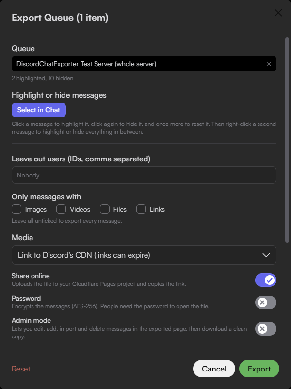
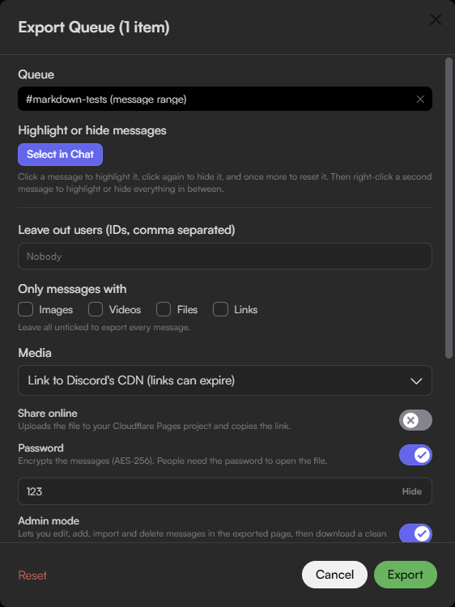
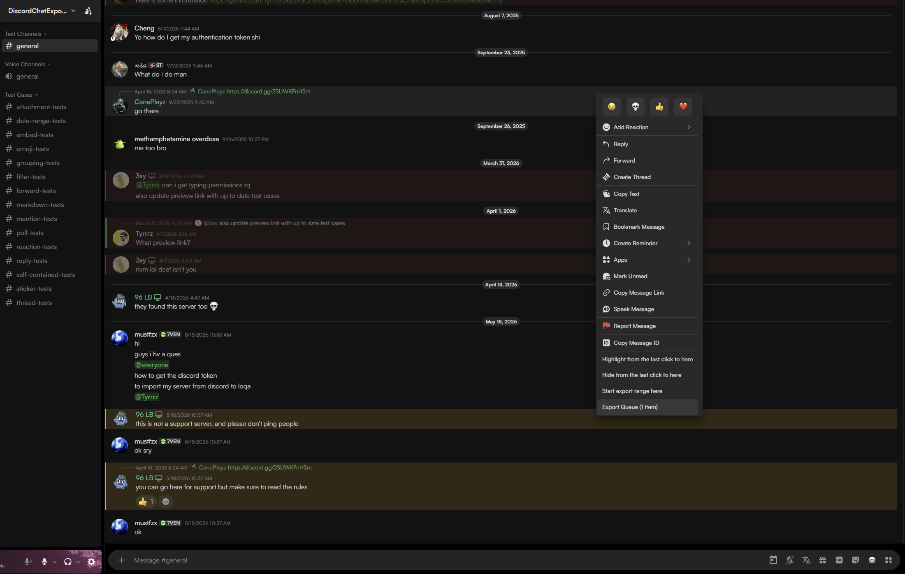
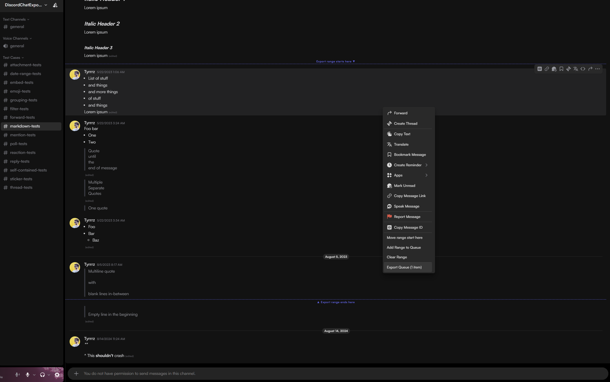
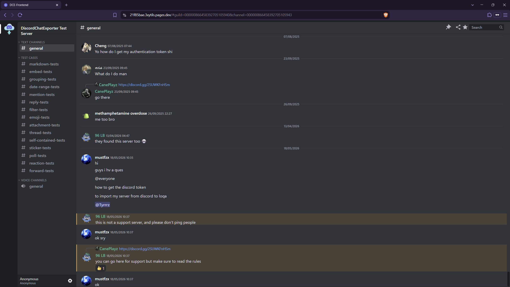
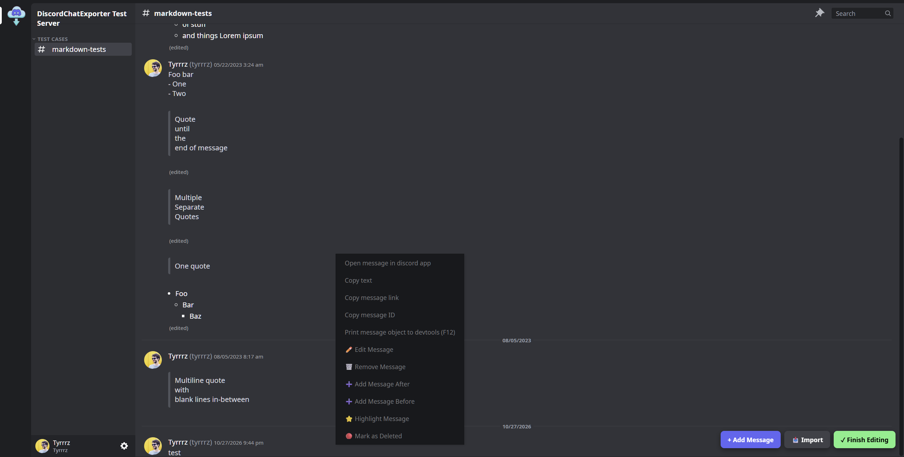
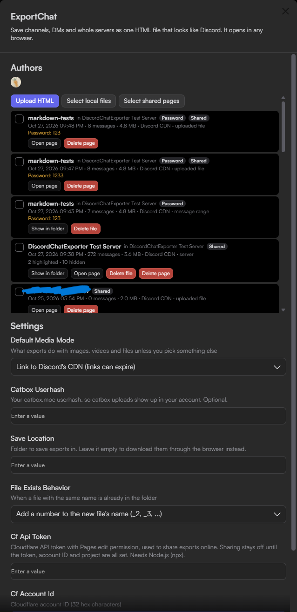

# ExportChat

Exports Discord channels, DMs, group DMs, threads and whole servers to a single HTML file. The file opens in any browser and renders like Discord.

## Features

- Export queue: combine channels, servers and message ranges into one file.
- Filters: date range, included or excluded user IDs, attachment type and a message limit.
- Highlight or hide individual messages before exporting.
- Media modes: link to Discord's CDN, embed in the file (Base64) or re-host on catbox.moe.
- Optional password encryption (AES-256-GCM, key derived with PBKDF2-SHA256).
- Admin mode: edit, add, import and delete messages in the exported page, then download a clean copy.
- Optional sharing to a Cloudflare Pages project.
- Export history in the plugin settings: open, share, copy links and delete exports.

## Screenshots

| Export window | Password and admin mode |
|---|---|
|  |  |

## Examples

| Example | Description |
|---|---|
| [21f85bae.3xytils.pages.dev](https://21f85bae.3xytils.pages.dev) | A whole-server export, shared through Cloudflare Pages. |
| [53441ffa.3xytils.pages.dev](https://53441ffa.3xytils.pages.dev) | A message-range export with a password and admin mode. Password: `123`. |

## Usage

1. Right-click a channel, DM, group DM or thread and choose **Export Chat**, or right-click a server and choose **Export Server**.
2. Set the options and click **Export**.
3. The file is saved to **Save Location**, or downloaded through the browser when that setting is empty.

| Task | Steps |
|---|---|
| Queue items | Choose **Add to Export Queue** or **Add Server to Export Queue**. The menu then shows **Export Queue (n items)**. |
| Export a range | Right-click a message, choose **Start export range here**, then **End export range here** on another. Then **Add Range to Queue**, or **Clear Range**. |
| Highlight or hide | Click **Select in Chat**. Click a message once to highlight, twice to hide, three times to reset. Right-click and choose **Back to Export** when done. |
| Share online | Fill in the three Cloudflare settings, then turn on **Share online**. The link is copied when the upload finishes. |
| Share an existing file | Use **Upload HTML** in the export history. Choose a copy without a password and set the password in the dialog. |

## Settings

| Setting | Default | Description |
|---|---|---|
| Default Media Mode | Link to Discord's CDN | Media handling unless changed in the export window: CDN links, embed in the file, or upload to catbox.moe. |
| Catbox Userhash | Empty | Optional catbox.moe userhash, so uploads appear in that account. |
| Save Location | Empty | Folder for exports. Empty downloads them through the browser. |
| File Exists Behavior | Add a number | When the file name exists: add `_2`, `_3` and so on, or replace the old file. |
| Cf Api Token | Empty | Cloudflare API token with Pages edit permission. |
| Cf Account Id | Empty | Cloudflare account ID (32 hex characters). |
| Cf Pages Project | Empty | Name of an existing Cloudflare Pages project. |

## Requirements

- Vencord built from source, in the Discord desktop app.
- For sharing only: a Cloudflare account with a Pages project, and Node.js with `npx` on Discord's PATH.

## Notes

### Sharing

- ExportChat runs `npx --yes wrangler@4.63.0 pages deploy`. The wrangler version is pinned.
- Each share deploys to its own random preview branch (`s-<random>`), never to production. Anyone with the link can open it. Use a password for private chats.
- On Windows, `node.exe` and `node_modules\npm\bin\npx-cli.js` must be in the same PATH folder, as the standard Node.js installer sets up. Shim-based Node managers such as Volta are not detected.
- Shares and uploads are capped at 25 MB per file. Delete shared pages from the export history when no longer needed.

### Limitations

- Large exports take time. Discord's API is rate limited, and embedded media grows the file quickly.
- CDN links stop working when Discord's links expire. Use Embed or catbox for exports that must last.
- At most 100 invite links per export become invite cards.
- Network folders (`\\server\share`) are not supported as the save location. Mapped drive letters work.
- **Show in folder** and **Delete file** in the export history work only for exports in the current save folder.

### Privacy

- The Cloudflare API token and catbox userhash are ordinary plugin settings and are uploaded by Vencord Settings Sync.
- catbox.moe uploads are public and permanent. In catbox mode, every Discord CDN and Twemoji file in the export is re-hosted there.
- A password encrypts the messages only. The page title (`Export: <name>`) and the IDs of highlighted messages stay readable.
- Admin mode's **Finish Editing** downloads an unencrypted copy. Its **Import** applies only light checks, so paste only trusted DCEF-format JSON.
- The export history is stored locally, not synced, and shows each export's password as a reminder.
- An opened export loads content from Discord's CDN (unless media is embedded), `files.catbox.moe` (catbox mode), `cdn.jsdelivr.net` (Twemoji) and embedded YouTube, Twitch, Spotify and Tenor players. These hosts see the viewer's IP address.

## Credits and license

The export viewer, `dcef-template.html`, is a modified build of [DiscordChatExporter-frontend (DCEF)](https://github.com/slatinsky/DiscordChatExporter-frontend) by slatinsky, licensed under the [GNU General Public License v3.0](https://www.gnu.org/licenses/gpl-3.0.html). The bundled file is distributed under the same license.

- It is a pre-built, minified copy of the DCEF viewer, changed for ExportChat. The DCEF version it was built from is not recorded; the upstream source is in the DCEF repository.
- The changes were made directly in the minified file, which is the preferred form for these changes. Its header comment lists them:
  - reads the export from `window.__DCEF_DATA` instead of the DCEF backend;
  - highlighted messages, invite cards and admin-mode hooks;
  - bundled Discord fonts (gg sans, Whitney) removed in favour of local and system fonts;
  - YouTube embeds use HTTPS;
  - the markdown renderer escapes every value taken from a message.
- Third-party code in the viewer keeps its own license: the Svelte runtime, moment.js, highlight.js, lottie-web and simple-markdown.

The rest of the plugin is GPL-3.0-or-later, like Vencord.

## Author

3xyy ([Discord](https://discord.com/users/596844241058267168)).
