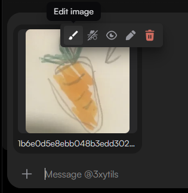
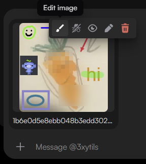
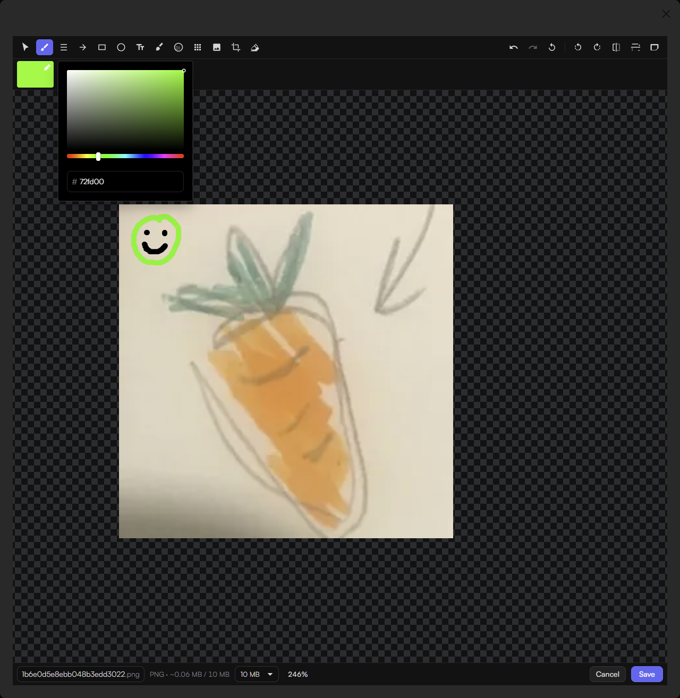
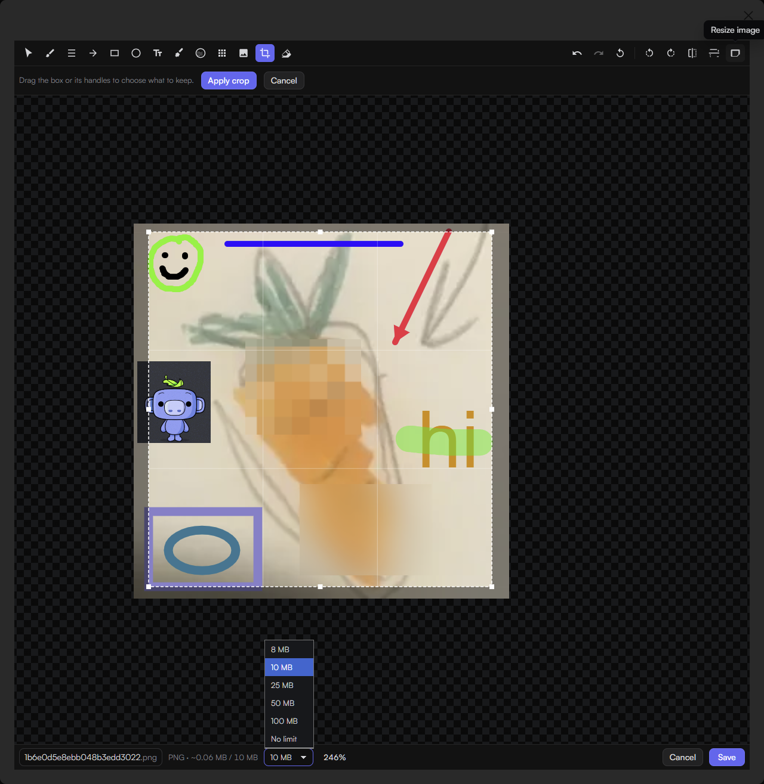
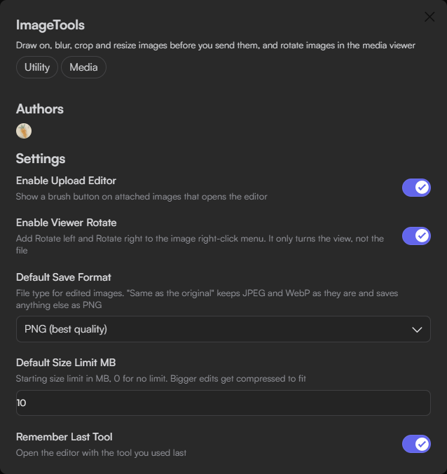

# ImageTools

Adds an image editor for attachments before they are sent: annotate, blur, pixelate, insert images, crop, rotate and resize. Also adds **Rotate left** and **Rotate right** to the image right-click menu.

## Features

- Drawing tools: Select, Brush, Line, Arrow, Rectangle, Ellipse, Text, Highlight, Blur, Pixelate, Insert, Crop and Eraser.
- Whole-image actions: rotate left or right, flip horizontally or vertically, resize, and **Start over**.
- Annotations stay editable until the message is sent.
- Zoom from 10% to 1600% and pan with the middle mouse button or Space and drag.
- Undo and redo, up to 50 steps.
- Save as PNG, WebP or the original format, with an optional size limit that compresses the result to fit.
- View-only rotation in the image viewer.

## Screenshots

| Before | After |
|---|---|
|  |  |

## Usage

1. Attach one or more images to a message without sending it.
2. Click the brush icon (**Edit image**) on an attachment. The brush in the message bar also works and asks which image to edit when there are several.
3. Edit the image.
4. Optionally change the file name in the bottom bar, then click **Save**. The attachment is replaced with the edited image.
5. Send the message.

### Keyboard and mouse

| Action | Input |
|---|---|
| Zoom | Ctrl+scroll, pinch, Ctrl+= and Ctrl+- |
| Fit to view | Ctrl+0, or click the zoom percentage |
| Pan | Middle mouse drag, or hold Space and drag |
| Undo | Ctrl+Z |
| Redo | Ctrl+Y or Ctrl+Shift+Z |
| Delete the selected object | Delete or Backspace |
| Deselect | Escape |

### Tool details

- **Insert** opens a file picker and places the image in the center, selected. Corner handles keep proportions; hold Shift to stretch. Inserted images move with the base image when it is rotated, flipped, resized or cropped.
- **Blur** and **Pixelate** cover everything beneath them, including inserted images and earlier drawings. Strength ranges from 1 to 100 and is measured in image pixels, so it looks the same at any zoom and in the saved file.

## Settings

| Setting | Default | Description |
|---|---|---|
| Enable Upload Editor | On | Shows the brush button on attached images and in the message bar. Requires a reload (Ctrl+R). |
| Enable Viewer Rotate | On | Adds **Rotate left** and **Rotate right** to the image right-click menu. Requires a reload (Ctrl+R). |
| Default Save Format | PNG | PNG, WebP, or **Same as the original** (JPEG and WebP keep their format, anything else saves as PNG). |
| Default Size Limit MB | 10 | Starting size limit in the bottom bar. 0 means no limit. |
| Remember Last Tool | On | Opens the editor with the last used tool. |

## Requirements

- Vencord built from source.

## Notes

- When an edit exceeds the size limit, it is saved as WebP and compressed: quality first, then dimensions.
- The file name extension follows the save format. Characters not allowed in file names are replaced with `_`.
- The original stays attached until Discord accepts the edited image. If Discord rejects it, for example over the upload limit, the editor stays open.
- Discord allows 10 attachments per message. Remove one before saving if the message already has 10.
- GIFs and other animated images are saved as a single still frame.
- Rotate, flip, resize, crop and **Start over** each store a full copy of the image, so at most 10 of those steps are kept in the undo history.
- Very large inserted images are scaled down to at most twice the size of the edited image.
- Viewer rotation changes only the display, not the file, and resets when the viewer redraws the image.
- The attachment brush depends on Discord's upload preview. If a Discord update removes it, the message bar brush still works.
- All processing is local. The edited image leaves the computer only when the message is sent.

## Author

3xyy ([Discord](https://discord.com/users/596844241058267168)). GPL-3.0-or-later.
