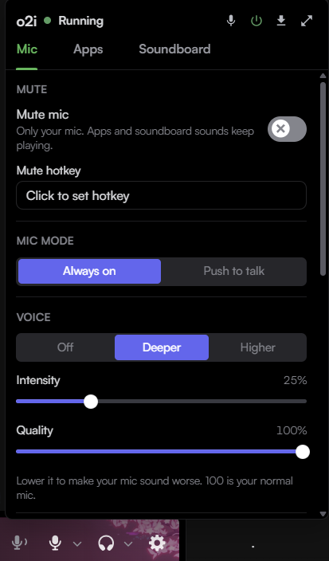
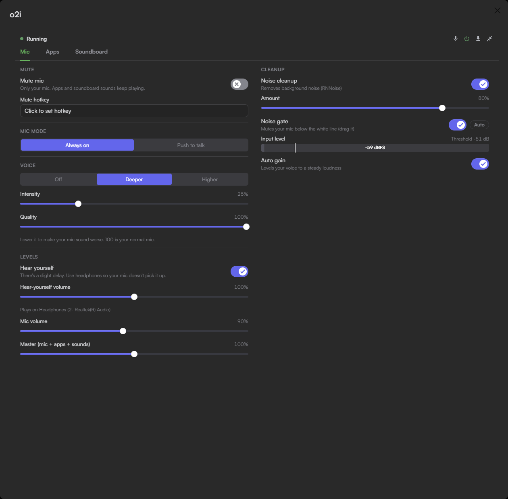
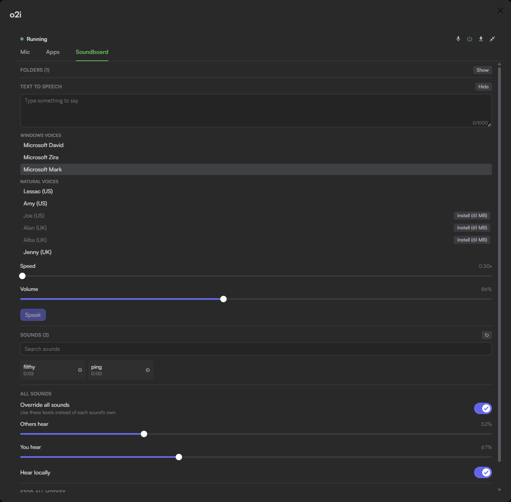
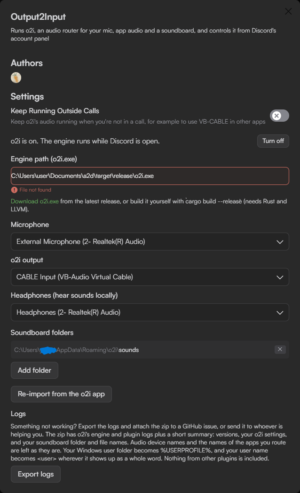

# Output2Input (o2i)

Output2Input mixes a processed microphone, the audio of selected apps, a soundboard and text to speech into one virtual microphone for Discord. The audio runs in `o2i.exe`, a separate engine that the plugin controls from a button next to Discord's mute and deafen buttons.

Vencord's plugin list shows it as **Output2Input**. The button and panel use **o2i**.

## Features

- Mic processing: noise cleanup (RNNoise), a noise gate with an automatic mode, auto gain, voice effects and a Quality slider that degrades the mic on purpose.
- Mic mute and push to talk, with keys that work while a game has focus.
- Per-app audio routing with volume, mute and ducking while speaking.
- A soundboard built from local folders, with per-sound hotkeys and volumes.
- Text to speech into the call, with Windows voices or downloadable natural voices.
- Automatic fallback to the real microphone if the engine stops during a call.
- Log export for bug reports, with the Windows user name redacted.

## Screenshots



| Mic | Soundboard |
|---|---|
|  |  |



## How it works

```
real mic + apps + soundboard + speech  ->  o2i.exe  ->  CABLE Input  ->  CABLE Output  ->  Discord
```

VB-CABLE passes audio played into **CABLE Input** out of **CABLE Output** as a microphone. Routed apps keep playing on the speakers. Audio runs only during a call or while the panel is open, unless **Keep Running Outside Calls** is on.

## Usage

### Setup

1. Install [VB-CABLE](https://vb-audio.com/Cable): unzip it, run the setup as administrator, click **Install Driver** and restart if prompted.
2. Download `o2i.exe` from the [latest release](https://github.com/3xyy/3xy-userplugins-vencord/releases/latest) into a permanent folder, for example `C:\Tools\o2i\o2i.exe`. To build it instead, see [o2i-rust-engine](../o2i-rust-engine).
3. Enable **Output2Input** in **Settings > Vencord > Plugins** and open its settings.
4. Paste the full path into **Engine path (o2i.exe)**. The field shows **Found** and the engine starts.
5. Select **Microphone** (the real mic), **o2i output** (`CABLE Input (VB-Audio Virtual Cable)`, the default) and **Headphones (hear sounds locally)**.
6. Click the o2i button in the account panel. If the panel shows **Fix**, click it. It sets Discord's input to CABLE Output and turns off Discord's noise suppression, Krisp, echo cancellation and automatic gain control.

### Panel

The header shows the engine status and four buttons: mute, power, export logs and expand. The o2i button shows a red slash while the mic is muted, and a plain slash while push to talk keeps it closed.

**Mic tab**

| Control | Function |
|---|---|
| Mute mic, Mute hotkey | Mutes the real mic only. Apps and sounds keep playing. |
| Mic mode, Push to talk key | **Always on**, or open only while the key is held. See [Push to talk](#push-to-talk). |
| Voice, Intensity | Off, Deeper or Higher. |
| Quality | Degrades the mic on purpose. 100 is the unmodified mic. |
| Noise cleanup, Amount | Removes background noise. |
| Noise gate, Auto | Mutes the mic below the white line on the level meter. Drag the line, or press **Auto** to follow the background noise. See [Noise gate notes](#noise-gate-notes). |
| Auto gain | Keeps the voice at a steady loudness. |
| Hear yourself | Plays the processed mic on the headphones, slightly delayed. |
| Mic volume, Master | 0 to 200%. Master covers the mic, apps and sounds. |

**Apps tab**

- **Add app** mixes a running app into the mic. Each app has a volume, **Mute** and remove. A green dot means it is being captured.
- **Lower apps while you talk** lowers routed apps to **Ducked volume** while speaking.

**Soundboard tab**

- Click a sound to play it. **Edit** sets its emoji, name, hotkey, **Others hear**, **You hear** and **Hear locally**.
- **Override all sounds**, under **All sounds**, applies one set of levels to every sound.
- **Now playing** has seek, pause, stop and volume per sound, plus **Stop all sounds** and a **Stop-all hotkey**.
- **Add folder** adds a folder. o2i lists its MP3, WAV, OGG, FLAC, M4A and AAC files, without subfolders.
- Sound hotkeys are F1 to F12, or a letter or digit with Ctrl or Alt (Shift optional), or Mouse3 to Mouse5 (middle and side buttons), alone or with Ctrl, Alt, Shift or Win.
  - Keyboard sound hotkeys do not reach the focused app.
  - Mouse sound hotkeys go through the low-level hook, so the press also reaches the focused app. When Discord itself is focused, Mouse4 and Mouse5 also act as back and forward in Discord.
- On first start, o2i copies two sounds to `%APPDATA%\o2i\sounds` and adds that folder once.

### Push to talk

- The mic opens while the key is held and closes 200 ms after release.
- The key can be any key, a key combination or Mouse3 to Mouse5. Like the mute key, it still reaches the focused app.
- Mute overrides push to talk. With no key set, the mic stays closed.
- Keep Discord's own push to talk off.

### Noise gate notes

- With the gate on, the mic has 40 ms of added latency.
- Sounds shorter than about 30 ms, such as keyboard clicks, never open the gate.
- Auto sets the threshold at least 6 dB above the raw mic floor.
- Clicks heard while talking are not removed.
- In a loud, steady background, a very quiet voice may not open the gate in Auto. Use a manual threshold.

### Text to speech

1. In the Soundboard tab, click **Show** next to **Text to speech**.
2. Choose a voice. **Windows voices** work without setup. **Natural voices** (Piper) show **Install** with the download size.
3. Type up to 1000 characters, set **Speed** (0.5x to 2x) and press Enter or **Speak**.

- Speech plays into the call through the soundboard, at the **All sounds** levels, and appears in **Now playing**.
- A natural voice is about 60 MB. The first one also downloads the 22 MB Piper runtime. Downloads come over HTTPS from the official rhasspy repositories, are checked against pinned SHA-256 hashes and work offline afterwards.
- If natural voices stop working, delete `%APPDATA%\o2i\tts\runtime` and install a voice again to reinstall the runtime.
- Six English voices are available. Each has its own dataset license. Voices are downloaded by the user, not bundled with o2i.

## Settings

| Setting | Default | Description |
|---|---|---|
| Keep Running Outside Calls | Off | Keeps audio running outside calls, for example to use VB-CABLE in other apps. |
| Power (Turn off, Turn on) | On | Off stops the engine, its hotkeys and the soundboard, and Discord returns to the real mic. Kept across restarts. |
| Engine path (o2i.exe) | Empty | Full path to `o2i.exe`. |
| Microphone | None | The real mic. A named device is required, also for the fallback. |
| o2i output | CABLE Input | Where o2i plays its mix. |
| Headphones (hear sounds locally) | System default | Output for **Hear locally** sounds and **Hear yourself**. |
| Soundboard folders | Default sounds folder | Same list as in the Soundboard tab. |
| Re-import from the o2i app | Button | Copies the settings saved by o2i's standalone window. |
| Export logs | Button | Same as the panel's export logs button. |

## Requirements

- Windows 11. Windows 10 is untested, and per-app capture needs a recent Windows build.
- The Discord desktop app with Vencord built from source. The browser and Vesktop are not supported.
- [VB-CABLE](https://vb-audio.com/Cable).
- `o2i.exe` from the [latest release](https://github.com/3xyy/3xy-userplugins-vencord/releases/latest), or built from [o2i-rust-engine](../o2i-rust-engine). New plugin features can require a newer engine.

## Notes

### Fallback

- If the engine stops during a call, Discord switches to the mic selected in **Microphone** and returns to CABLE Output when o2i recovers. If that mic is missing, a message asks to choose one in Discord's Voice settings. The engine restarts by itself after a crash.
- If o2i was muted or on push to talk, Discord switches to the real mic muted. The previous Discord mute returns on recovery.
- Disabling the plugin stops the engine and restores the Discord voice settings that **Fix** changed.

### Limitations

- Only one o2i can run audio at a time: the plugin's engine or the standalone window.
- The mute and push to talk keys do not work while an elevated (administrator) window has focus.
- A bare letter or digit as the mute key also toggles while typing. Side mouse buttons may also navigate back or forward in Discord.
- The account panel button and **Fix** depend on Discord's UI and can break after a Discord update.

### Privacy

- The only network access is the natural voice download, started with **Install**.
- Logs are in `%APPDATA%\o2i\logs` (`engine.log`, `plugin.log`, rotated at 5 MB) and include device names, app names and sound file paths.
- **Export logs** saves a zip to Downloads with both logs and a `summary.json` (versions, o2i settings, audio devices, Discord voice settings, soundboard file names). The Windows user folder becomes `%USERPROFILE%` and the user name `<user>`. Device and app names are kept. Review the zip before posting it publicly.
- o2i settings are included in Vencord Settings Sync.

## Author

3xyy ([Discord](https://discord.com/users/596844241058267168)). GPL-3.0-or-later.
